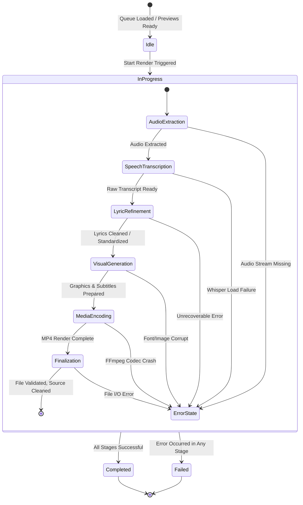

# Data Model: Granular Render Progress Tracking & Predictive Estimation

**Feature**: Granular Render Progress Tracking and Predictive Estimation  
**Branch**: `001-render-progress-prediction`  
**Date**: 2026-11-04  

---

## Entities & Schemas

### 1. RenderStage
Represents an individual atomic phase within the video generation lifecycle.

```typescript
interface RenderStage {
  id: "audio_extraction" | "speech_transcription" | "lyric_refinement" | "visual_generation" | "media_encoding" | "finalization";
  label: string;              // e.g., "Trích xuất âm thanh", "Chuyển giọng nói sang chữ", "Làm sạch lời bài hát AI"
  order: number;              // 1 to 6
  status: "pending" | "active" | "completed" | "failed";
  started_at?: number;        // Epoch timestamp (seconds or ms)
  finished_at?: number;       // Epoch timestamp
  duration_s?: number;        // Elapsed duration in seconds for this stage
  error_message?: string;     // Populated if status is "failed"
}
```

### 2. ItemProgressState
Represents live, observable rendering state for an item in the queue.

```typescript
interface ItemProgressState {
  item_id: number | string;
  video_name: string;
  status: "idle" | "processing" | "completed" | "error";
  current_stage_id: string | null;
  current_stage_label: string;
  percent: number;            // 0 to 100
  elapsed_s: number;          // Total elapsed time since render started
  estimated_total_s: number;  // Predicted total time required
  estimated_remaining_s: number; // Predicted seconds left
  stages: RenderStage[];      // Detailed breakdown of all 6 stages
  error?: string;
  output_file?: string;
}
```

### 3. RenderTelemetryRecord
Persistent empirical execution record saved upon completion of each render.

```typescript
interface RenderTelemetryRecord {
  id: string;                 // e.g. "tel_1730700000_1"
  timestamp: string;          // ISO 8601 (e.g. "2026-11-04T15:30:00Z")
  video_name: string;
  input_duration_s: number;   // Source video length in seconds
  input_size_mb: number;      // Source video file size in MB
  stage_durations: {
    audio_extraction: number;
    speech_transcription: number;
    lyric_refinement: number;
    visual_generation: number;
    media_encoding: number;
    finalization: number;
  };
  api_latency_ms: number;     // Remote Gemini API round-trip latency (0 if offline/skipped)
  total_duration_s: number;   // Total end-to-end seconds
  status: "completed" | "failed";
}
```

### 4. PredictionModelProfile
Statistical model computed dynamically from stored telemetry records to estimate future render durations.

```typescript
interface PredictionModelProfile {
  sample_count: number;       // Number of valid historical records (0 to 100)
  is_cold_start: boolean;     // True if sample_count < 3
  avg_duration_ratio: number; // Ratio of (local processing seconds) / (source video seconds)
  avg_size_coefficient: number; // Additional weight per MB
  rolling_api_latency_ms: number; // Rolling average of recent Gemini API calls
  stage_weight_distribution: Record<string, number>; // Normalized fraction of time spent in each stage (sum = 1.0)
}
```

---

## State Transitions

### Render Lifecycle Progression


---

## Storage & File Paths

| File | Purpose | Storage Schema / Format |
|------|---------|-------------------------|
| `data/render_telemetry.json` | Stores array of up to 100 `RenderTelemetryRecord` objects | JSON Array of objects, automatically trimmed FIFO |
| In-Memory State (`ProgressManager`) | Live dictionary of active `ItemProgressState` items keyed by `item_id` | Thread-safe Python dictionary with mutex lock |

