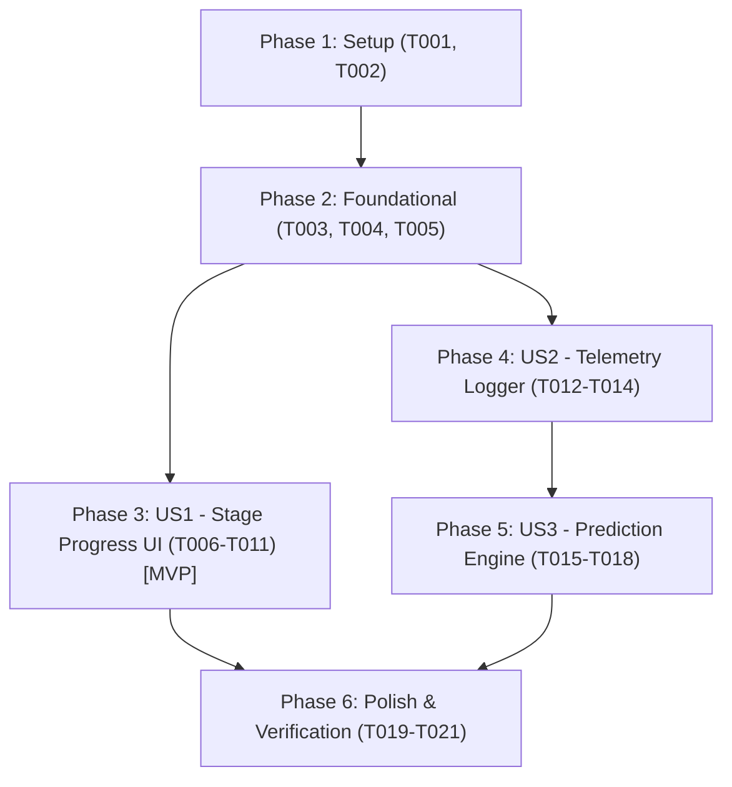

# Tasks: Granular Render Progress Tracking and Predictive Estimation

**Input**: Design documents from `specs/001-render-progress-prediction/` (`spec.md`, `plan.md`, `research.md`, `data-model.md`, `contracts/render-progress-api.md`, `quickstart.md`)  
**Prerequisites**: `plan.md`, `spec.md`, `data-model.md`, `contracts/`  
**Tests**: Verification via runnable scenarios in `quickstart.md` (no automated TDD harness requested in spec)  
**Organization**: Tasks are grouped by user story to enable independent implementation and testing of each story.

## Format: `[ID] [P?] [Story] Description`

- **[P]**: Can run in parallel (different files, no dependencies on incomplete tasks)
- **[Story]**: Which user story this task belongs to ([US1], [US2], [US3])
- Includes exact file paths in each task description

---

## Phase 1: Setup (Shared Infrastructure)

**Purpose**: Project initialization and directory scaffolding for services and local telemetry data.

- [X] T001 Create `services/` package directory and initialize `services/__init__.py`
- [X] T002 Create `data/` directory for local telemetry persistence in `data/render_telemetry.json`

---

## Phase 2: Foundational (Blocking Prerequisites)

**Purpose**: Core state management and pipeline service modules that MUST be complete before user stories can execute.

⚠️ **CRITICAL**: Foundational tasks block user story implementation.

- [X] T003 [P] Implement thread-safe `ProgressManager` state store in `services/progress_manager.py` with mutex-protected methods for updating and querying `ItemProgressState` and `RenderStage`
- [X] T004 [P] Implement `TelemetryManager` in `services/telemetry_manager.py` to read/write JSON telemetry records in `data/render_telemetry.json`, maintaining a rolling window capped at 100 entries
- [X] T005 Extract monolithic rendering logic from `app.py` into a modular `RenderPipeline` class in `services/render_pipeline.py` accepting progress callback hooks for the 6 sequential stages (`audio_extraction`, `speech_transcription`, `lyric_refinement`, `visual_generation`, `media_encoding`, `finalization`)

**Checkpoint**: Foundation ready — user story implementation can begin.

---

## Phase 3: User Story 1 - Granular Stage Progress Visibility (Priority: P1) 🎯 MVP

**Goal**: Provide content creators with real-time, sequential visibility of all 6 rendering stages in a compact badge that expands on click into an inline stage timeline with live elapsed timers.

**Independent Test**: Queue a single video, start rendering, and observe sequential UI transitions through each distinct stage with elapsed timer updates, expanding the row to verify stage timings without page reloads.

### Implementation for User Story 1

- [X] T006 [US1] Connect `RenderPipeline` stage callbacks to `ProgressManager.update_stage()` in `services/render_pipeline.py` to emit live transitions and elapsed time for all 6 stages
- [X] T007 [US1] Implement `GET /api/render-progress` endpoint in `app.py` returning active stage states, per-item stage breakdown, elapsed seconds, and overall queue summary per `contracts/render-progress-api.md`
- [X] T008 [US1] Refactor `POST /api/render-single` in `app.py` to initialize progress state in `ProgressManager` and execute rendering through `RenderPipeline`
- [X] T009 [US1] Add compact status badge with active stage label, spinning indicator, and click-to-expand accordion row toggle in `templates/index.html`
- [X] T010 [US1] Implement client-side polling loop (500ms interval) in `templates/index.html` that queries `/api/render-progress` during batch render and updates badges and expanded timeline items
- [X] T011 [US1] Add CSS styles for stage status badges (pending, active, completed, failed), spinning animation, and expandable timeline view in `templates/index.html`

**Checkpoint**: User Story 1 is fully functional and independently testable as an MVP increment.

---

## Phase 4: User Story 2 - Render Telemetry & Performance Data Collection (Priority: P2)

**Goal**: Automatically record empirical performance metrics (video duration, file size, individual stage durations, Gemini API round-trip latency, total time) for every completed render in local storage.

**Independent Test**: Render at least one video, then call `GET /api/render-telemetry` or inspect `data/render_telemetry.json` to verify that performance records persist across server restarts with all required fields.

### Implementation for User Story 2

- [X] T012 [US2] Track precise start and end timestamps for each individual stage and measure remote Gemini API round-trip latency in milliseconds within `services/render_pipeline.py`
- [X] T013 [US2] Invoke `TelemetryManager.record_render(...)` at the end of the `finalization` stage in `services/render_pipeline.py` to persist completed render metrics
- [X] T014 [US2] Implement `GET /api/render-telemetry` endpoint in `app.py` per contract to expose historical telemetry records and statistical profile summaries

**Checkpoint**: User Stories 1 and 2 work independently. Completed renders continuously build up performance history.

---

## Phase 5: User Story 3 - Predictive Render Time Estimation (Priority: P3)

**Goal**: Calculate upfront estimated render durations for queued items and live countdown timers for active renders using empirical device ratios and rolling API latency, with cold-start heuristics for new systems (<3 renders).

**Independent Test**: Queue videos of varying duration/size, verify that upfront estimates appear on queue rows and the toolbar, and observe that the active render counts down remaining time dynamically as stages conclude.

### Implementation for User Story 3

- [X] T015 [US3] Implement hybrid prediction calculation in `services/telemetry_manager.py` using empirical hardware duration ratios, rolling Gemini API latency, cold-start fallback (`1.5 * duration + 4.0s`), and clamping rules
- [X] T016 [US3] Implement `GET /api/render-predictions` endpoint in `app.py` returning upfront duration estimates and queue total time for all items in `session_data['queue']`
- [X] T017 [US3] Update `loadFolders()` in `templates/index.html` to fetch predictions from `/api/render-predictions` and render initial estimated duration badges and overall queue batch ETA
- [X] T018 [US3] Update active render polling in `templates/index.html` to display dynamic remaining countdown (`estimated_remaining_s`) on the active item progress bar

**Checkpoint**: All three user stories are functional and provide an end-to-end intelligent rendering dashboard.

---

## Phase 6: Polish & Cross-Cutting Concerns

**Purpose**: Hardening, error visibility, edge case handling, and verification.

- [X] T019 [P] Update error handlers in `services/render_pipeline.py` and `app.py` to highlight the exact failing stage in `ProgressManager` and gracefully handle pipeline aborts
- [X] T020 Run end-to-end verification scenarios in `specs/001-render-progress-prediction/quickstart.md` (cold-start predictions, live stage transitions, telemetry persistence, ETA refinement)
- [X] T021 Code cleanup and docstrings verification across `services/` and `app.py`

---

## Dependencies & Execution Order

### Phase Dependencies

- **Setup (Phase 1)**: No dependencies — can start immediately.
- **Foundational (Phase 2)**: Depends on Phase 1 — BLOCKS all user stories.
- **User Story 1 (Phase 3)**: Depends on Phase 2 — Deliverable as MVP.
- **User Story 2 (Phase 4)**: Depends on Phase 2 & T005 from Phase 2; can build on US1 pipeline hooks.
- **User Story 3 (Phase 5)**: Depends on Phase 4 (relies on telemetry recorded in US2).
- **Polish (Phase 6)**: Depends on all user stories being complete.

### User Story Dependencies

### Parallel Opportunities

- T003 (`progress_manager.py`) and T004 (`telemetry_manager.py`) can be implemented in parallel.
- Frontend styling task T011 can run in parallel with endpoint wiring in T007.
- T019 (error handler hardening) can run in parallel with T021 (documentation cleanup).

---

## Implementation Strategy

### MVP First (User Story 1 Only)
1. Complete Phase 1: Setup (`services/` and `data/`).
2. Complete Phase 2: Foundational (`ProgressManager`, `TelemetryManager`, `RenderPipeline`).
3. Complete Phase 3: User Story 1 (real-time 6-stage progress, expandable timeline, polling loop).
4. **STOP and VALIDATE**: Verify live stage transitions and UI responsiveness on a test video.

### Incremental Delivery
1. Add User Story 2: Track stage timings and persist telemetry to `data/render_telemetry.json`.
2. Add User Story 3: Wire prediction formula and display upfront ETAs and countdown timers.
3. Complete Polish: Validate all scenarios in `quickstart.md`.

