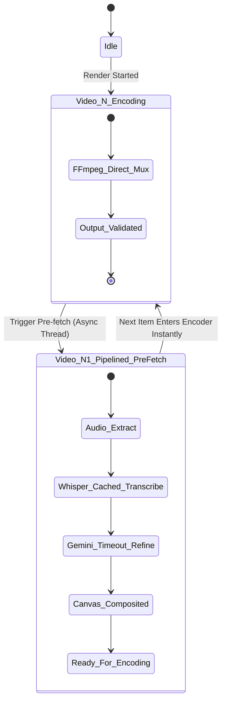

# Data Model: Fast Video Render Pipeline & Performance Optimization

**Feature**: `006-render-speed-optimization`  
**Date**: 2026-11-09  
**Status**: Completed  

---

## 1. Entities

### 1.1 `EncoderProfile`
Represents the detected or user-configured video encoding backend and execution parameters.

| Field | Type | Description | Default / Values |
|:------|:-----|:------------|:-----------------|
| `backend` | `str` | Active FFmpeg video encoder | `"h264_nvenc"`, `"h264_qsv"`, `"h264_amf"`, `"h264_mf"`, `"libx264"` |
| `preset` | `str` | Encoding speed vs compression preset | `"ultrafast"`, `"veryfast"` |
| `is_hardware_accelerated` | `bool` | True if GPU hardware encoder is active | Auto-detected |
| `threads` | `int` | Worker thread count (0 = auto all cores) | `0` |
| `pixel_format` | `str` | Target pixel format | `"yuv420p"` |
| `crf` | `int` | Constant Rate Factor quality balance | `23` |

### 1.2 `WhisperModelCache`
Singleton holding in-memory weights of the speech recognition engine to prevent disk reloads.

| Field | Type | Description | Default / Values |
|:------|:-----|:------------|:-----------------|
| `engine_type` | `str` | Active speech recognition library | `"faster-whisper"` (if available), else `"whisper"` |
| `model_name` | `str` | Name of model weights | `"small"` or `"base"` |
| `device` | `str` | Compute target | `"cuda"` if GPU available, else `"cpu"` |
| `compute_type` | `str` | Model precision | `"float16"` (CUDA), `"int8"` or `"float32"` (CPU) |
| `is_loaded` | `bool` | Whether weights are resident in RAM | `True` after warm-up |
| `load_duration_s` | `float` | Duration spent during first-time loading | Seconds |

### 1.3 `PipelinedJobState`
Transient state tracking background pre-fetching of Audio + Whisper + Gemini stages for upcoming queue items.

| Field | Type | Description | Default / Values |
|:------|:-----|:------------|:-----------------|
| `item_id` | `int` | Corresponding queue item ID | Unique integer |
| `prep_status` | `str` | Pre-processing execution state | `"pending"`, `"in_progress"`, `"ready"`, `"failed"` |
| `temp_audio_path` | `str` | Path to extracted audio file | `outputs/temp_audio_<id>.mp3` |
| `full_lyrics` | `str` | Refined lyrics text from Gemini or fallback | Clean text |
| `has_lyrics` | `bool` | Whether lyrics are valid for display | `True` / `False` |
| `canvas_path` | `str` | Pre-rendered final 1080x1920 canvas image | `outputs/temp_canvas_<id>.png` |
| `error_message` | `Optional[str]` | Error message if pre-processing failed | `None` |

### 1.4 `RenderTelemetryBenchmark`
Extended telemetry recording detailed speedup ratios and active hardware parameters.

| Field | Type | Description | Default / Values |
|:------|:-----|:------------|:-----------------|
| `encoder_backend` | `str` | Name of encoder used for the render | E.g. `"h264_qsv"`, `"libx264"` |
| `whisper_engine` | `str` | Name of transcription engine | E.g. `"whisper_cached"`, `"faster_whisper"` |
| `pipelined` | `bool` | Whether pre-fetch pipelining was active | `True` / `False` |
| `encoding_speed_fps` | `float` | Effective encoding frame rate | E.g. `120.0 fps` |
| `speedup_factor` | `float` | Total speedup compared to ~200s baseline | E.g. `4.2x` |

---

## 2. State Lifecycle & Transitions

