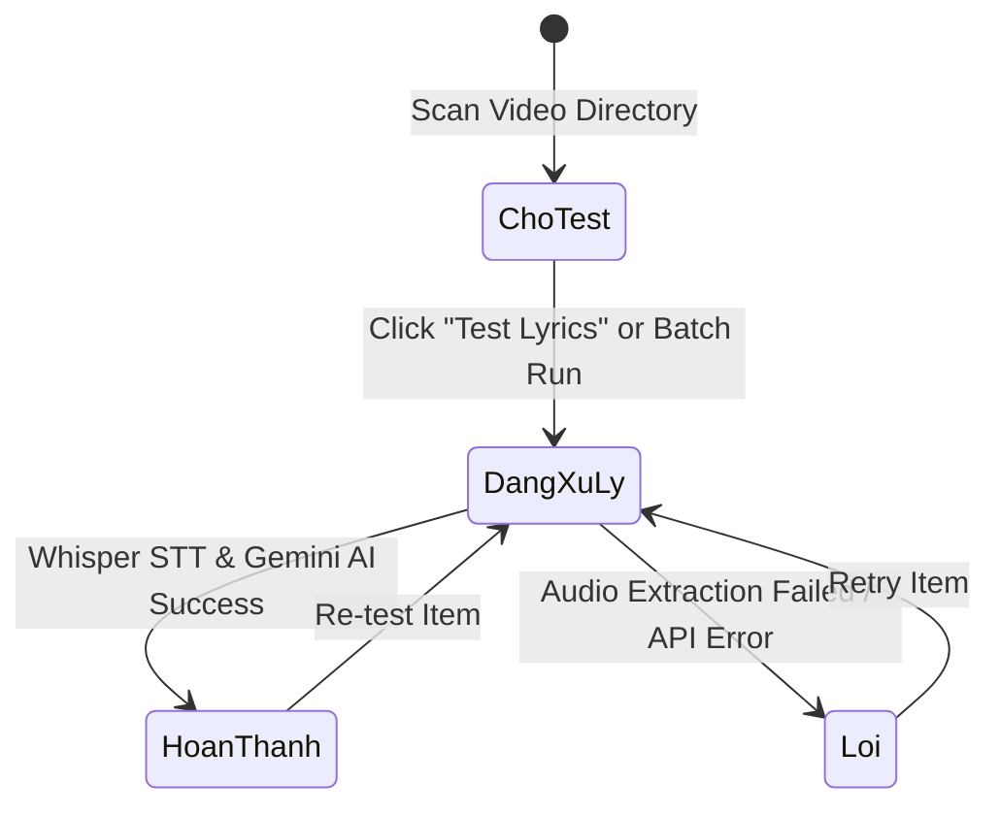

# Data Model: Lyrics Testing Page (/test)

**Feature**: `007-lyrics-test-page`  
**Date**: 2026-11-21  

---

## 1. Entities & Data Structures

### 1.1 `LyricsTestItem` (Queue Representation)
Represents a source video queued for lyrics testing on `/test`.

| Field | Type | Description | Values / Examples |
|:------|:-----|:------------|:------------------|
| `id` | `int` | Sequential item index in queue | `0`, `1`, `2` |
| `video_name` | `str` | Base filename of source video | `"chill_song_01.mp4"` |
| `video_path` | `str` | Absolute path on filesystem | `"D:\Media\Videos\chill_song_01.mp4"` |
| `duration_s` | `float` | Estimated or probed audio duration | `32.5` |
| `size_mb` | `float` | Video file size in megabytes | `1.45` |
| `status` | `str` | Current testing state | `"Chờ test"`, `"Đang xử lý"`, `"Hoàn thành"`, `"Lỗi"` |
| `raw_lyrics` | `str` | Unprocessed transcript from Whisper | Raw text |
| `refined_lyrics` | `str` | Cleaned / identified lyrics from Gemini | Cleaned text |
| `lyric_source` | `str` | Attribution source indicator | `"AI"`, `"Original"`, `"None"` |
| `first_line` | `str` | Extracted title / first lyric line | `"Cuộc sống xô bồ..."` |
| `processing_time_s`| `float` | Processing duration in seconds | `7.3` |
| `error_message` | `Optional[str]` | Detailed error message if failed | `None` |

---

### 1.2 `LyricsTestResponse` (API Response)
Returned by `POST /api/test-lyrics`.

```json
{
  "success": true,
  "item_id": 0,
  "raw_lyrics": "Hôm nay trời đẹp quá anh ơi dắt em đi dạo",
  "refined_lyrics": "Hôm nay trời đẹp quá anh ơi, dắt em đi dạo phố quanh co...",
  "lyric_source": "AI",
  "first_line": "Hôm nay trời đẹp quá anh ơi",
  "duration_s": 32.5,
  "processing_time_s": 5.8,
  "error": null
}
```

---

## 2. State Lifecycle & Transitions


