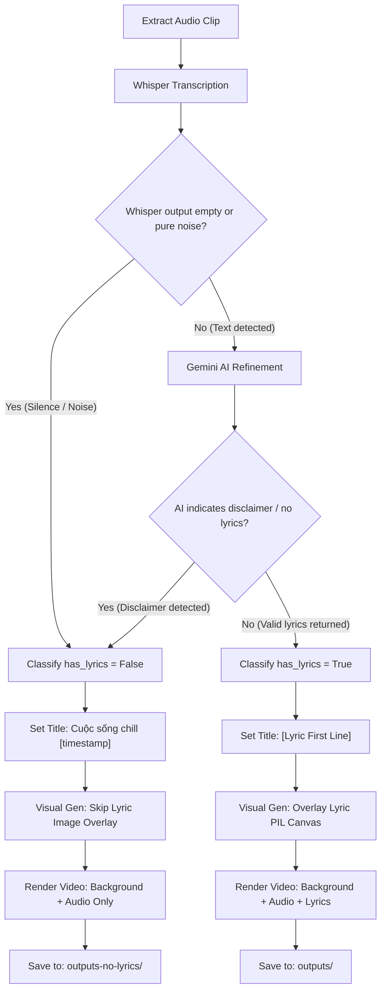

# Data Model: No-Lyrics Fallback & Chill Video Naming

**Feature**: `008-no-lyrics-fallback`  
**Date**: 2026-11-21  
**Status**: Completed  

---

## Entities & Schemas

### 1. VideoQueueItem / VideoDbRecord

Represents a video in the rendering queue and persistent database (`videos_db.json`).

| Field | Type | Description | Non-Lyric Value |
|---|---|---|---|
| `id` | `int` / `str` | Unique item identifier | `0, 1, 2...` |
| `video_name` | `str` | Original source video filename | e.g. `sample.mp4` |
| `video_path` | `str` | Path to original source file | e.g. `Videos/Chưa đăng/sample.mp4` |
| `title` | `str` | Display title and output base name | `"Cuộc sống chill [timestamp]"` |
| `duration_s` | `float` | Duration in seconds | e.g. `30.5` |
| `has_lyrics` | `bool` | Whether valid lyrics were found and rendered | `False` |
| `lyric_source` | `str` | Source of lyrics (`"AI"`, `"Original"`, or `"None"`) | `"None"` |
| `first_line` | `str` | Short title summary | `"Cuộc sống chill [timestamp]"` |
| `raw_lyrics` | `str` | Raw Whisper output (if any) | `""` or raw noise |
| `refined_lyrics` | `str` | AI cleaned lyrics | `""` |
| `output_filename` | `str` | Filename of rendered output | `"Cuộc sống chill [timestamp].mp4"` |
| `output_path` | `str` | Full path to rendered output | `outputs-no-lyrics/Cuộc sống chill [timestamp].mp4` |
| `target_folder` | `str` | Target directory name | `"outputs-no-lyrics"` |
| `status` | `str` | Workflow status | `"Chờ duyệt"`, `"Đang render"`, `"Đã duyệt"` |

---

### 2. LyricAnalysisResult

Data structure returned by `process_video_to_perfect_lyrics` or lyrics analysis stages.

| Field | Type | Description |
|---|---|---|
| `has_lyrics` | `bool` | True if audio contains authentic song lyrics, False otherwise |
| `full_lyrics` | `str` | Formatted lyrics (empty string if `has_lyrics == False`) |
| `lyric_source` | `str` | `"AI"`, `"Original"`, or `"None"` |
| `first_line` | `str` | Cleaned title for naming |
| `fallback_title` | `str` | `"Cuộc sống chill {timestamp}"` when `has_lyrics == False` |

---

## State Lifecycle & Decision Flow

